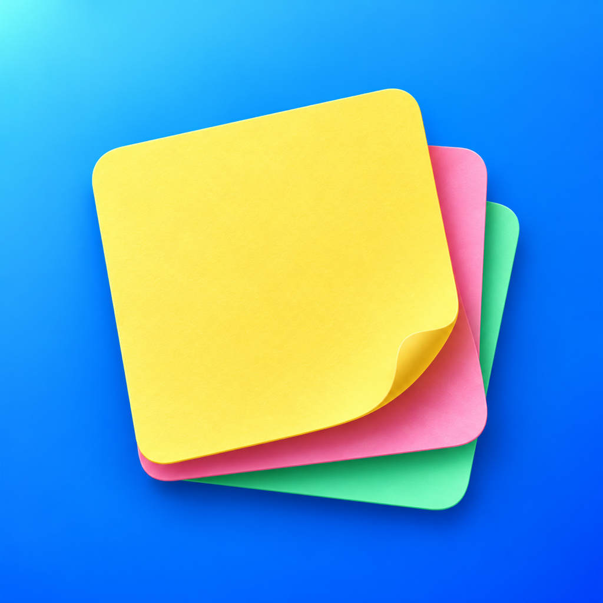

  

<h1 align="center">Desklet</h1>

Desklet turns your iPhone or iPad into a glanceable desk board for the notes that matter now. Create colourful notes, arrange them your way, then switch to Desk Mode to keep useful information in sight while you work.

  

## Features

- Create free-form notes in five colours.
- Drag notes into the order that suits you.
- Display large, readable notes in portrait or landscape Desk Mode.
- Choose vertical or horizontal scrolling, with an optional date and time.
- Keep the screen awake while Desk Mode is active.
- Store notes and preferences on your device, with no account or analytics.

## Requirements

- iPhone or iPad running iOS or iPadOS 27 or later.

## Getting started

Open Desklet, create a note, and choose a colour. Add more notes and drag them into your preferred order, then enter Desk Mode and place your device on a stand. Use Settings to adjust the display, scrolling direction, and date and time.

## About this repository

This repository contains the public Desklet website hosted with GitHub Pages. It describes and supports the app, but does not contain the SwiftUI app source code.

- [Website](https://zacharyfarnes.github.io/Desklet/)
- [Support](https://zacharyfarnes.github.io/Desklet/support/)
- [Privacy Policy](https://zacharyfarnes.github.io/Desklet/privacy/)

## App Review recording

[Watch the App Review demonstration](https://zacharyfarnes.github.io/Desklet/app-review/).
The `app-review/` folder contains the original MOV and an H.264 MP4 copy for browser playback.
